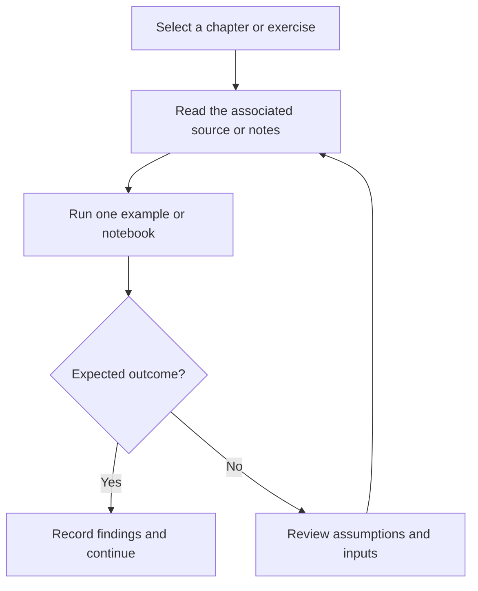

# Algorithm Design and Analysis — Java

Standalone Java exercises for array operations, linear search, binary search, and algorithm practice.

## Project focus

Java exercises. Use the directory map to choose a focused example or learning topic instead of treating the repository as one application.

## Workflow



## Repository structure

| Path | Purpose |
| --- | --- |
| [`AddArrayUsingMethod.java`](AddArrayUsingMethod.java) | Standalone programming exercise or example. |
| [`BinarySearch/`](BinarySearch) | Project-specific source, resources, or learning material. |
| [`Linear Search/`](Linear%20Search) | Project-specific source, resources, or learning material. |
| [`ThreeWayOfCreatingArray.java`](ThreeWayOfCreatingArray.java) | Standalone programming exercise or example. |
| [`ThreeWayOfPrintingArray.java`](ThreeWayOfPrintingArray.java) | Standalone programming exercise or example. |

## Getting started

```bash
git clone https://github.com/Raimal-Raja/Design-Analysis-of-Algorithm-Java.git
cd Design-Analysis-of-Algorithm-Java
```

Use a JDK. Compile individual exercises from their own directories; some folders reuse class names.

```bash
javac AddArrayUsingMethod.java
```

Run the class containing `public static void main` from the corresponding package/class directory.

## Verification

Compile or run one exercise at a time, test ordinary and boundary inputs, and compare the output with its stated problem. A successful build is not proof of algorithmic correctness.

## Contributing

Include reproduction steps, the affected path, expected behavior, and the checks you ran. Keep credentials, generated environments, and unnecessary build artifacts out of commits.

## License

No top-level license file is currently tracked. Check reuse permissions with the repository owner.
